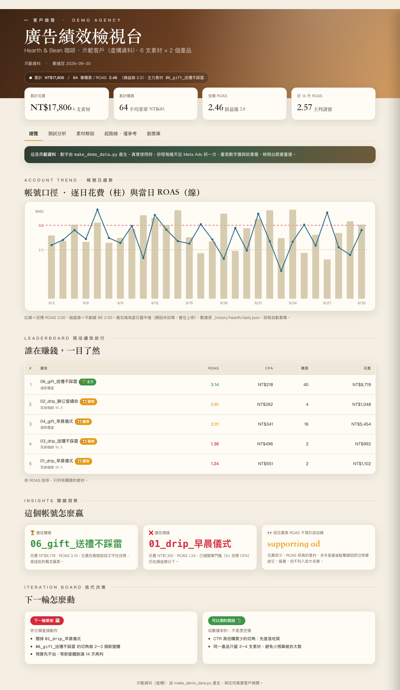

# Meta Ads Performance Dashboard（廣告績效檢視台）

A static dashboard system for watching several clients' Meta ad accounts through the same lens: which creatives make money, which ones to cut, and what to test next. It builds one self-contained HTML page per client plus an overview, and can publish the whole thing to any static host behind client-side encryption.

**Live demo with made-up data:** https://max-aiutopia.github.io/meta-ads-dashboard/ · encrypted version: [locked.html](https://max-aiutopia.github.io/meta-ads-dashboard/locked.html) (password `demo-password-123`)



This repo contains the method and the code, not real data. The clients, numbers, creatives and copy in the demo are generated by `make_demo_data.py`. The real version ran on live Meta Ads data for several e-commerce accounts.

[中文說明在下面](#中文說明)

## How it works

### 1. Data comes in layers

Each client has a set of JSON files. A scheduled job rewrites them, so the dashboard is rebuilt from data and never edited by hand.

| Layer | File | Written by | Contents |
|---|---|---|---|
| Numbers | `_live/<slug>.json` | scheduled pull from Meta Ads | campaign totals (lifetime / yesterday / 7 days / 14 days), every creative, ad sets, funnel |
| Narrative | `_live/<slug>_narrative.json` | scheduled analysis | KPI cards, banner, insights, next-round decisions, footnotes |
| Breakdown | `_live/<slug>_det.json` | scheduled pull | spend and purchases by placement, age and gender for each creative |
| Assets | `_live/<slug>_assets.json` | when new creatives appear | image, hook and the copy as it actually ran |
| History | `_history/<slug>/daily.json` | merged on each run | daily `[spend, purchases, ROAS]` for the trend charts |

In my setup the scheduled job was a Claude agent with read-only access to Meta Ads through MCP. It pulled the numbers, reconciled ad-set totals against the campaign total, and wrote the narrative layer. It never changed any ad settings.

### 2. One template, thin per-client files

- `dashlib.py` is the only template. Change it and every client page changes.
- `dashlive.py` turns the JSON layers into what the template needs: creative cards, tables, the spend × ROAS scatter, the leaderboard and trend series.
- `data_<slug>.py` holds only what's specific to a client: creative images and copy, the filters for the creative library (product × angle), the baseline, brand colors.

### 3. The decision logic

The point of the dashboard is to answer "scale it, keep watching, or cut it" the same way every time.

- **Judge on the last 14 days, not lifetime.** Lifetime numbers drag in the early learning phase.
- **Spend has to be big enough before you judge.**
  - Under 2× target CPA: not tested yet, don't cut.
  - 2× target CPA with zero purchases: cut. Accounts without a CPA cap are only ever marked "watch", never "cut".
  - Purchases but CPA above 1.5× target: cut.
  - Within 50% of target: watch.
  - 3× target CPA and still 50% off: cut.
- **A winner needs both results and scale.** It must hit the target ROAS *and* sit in the top 10% of the account's spend. The threshold is the 90th percentile of spend, so it adapts to each account's budget.
- **Low spend + high ROAS is a "supporting ad", not a scaling candidate.** Last-click attribution tends to credit these. Keep them, don't add budget.
- **ROAS colors are tied to each client's break-even:** green ≥ 1.5× break-even, gold ≥ break-even, red below. Break-even comes from that client's margins, not a global number.

These rules live in `dashlive.classifier()` and drive the scatter plot counters and the tags on every card.

### 4. What each page shows

- **Overview:** KPI cards, a banner with this round's headline, daily spend (bars) vs ROAS (line) with target and break-even lines, a leaderboard of creatives that sold, insights, and an iteration board.
- **Test analysis:** spend × ROAS scatter with the four classes counted, plus a per-batch table.
- **Creative X-ray:** every live creative as a card. Click one for its placement / age / gender breakdown, its 14-day trend and the exact copy that ran.
- **Baseline:** the previous batch's results, so a new batch is compared with something real.
- **Creative library:** all creatives filtered by product × angle, with their status.

### 5. Publishing behind a password, on a free static host

`build_artifact.py` merges the overview and every client page into one file (client pages load in isolated iframes). Clients are split into active and ended; ended clients keep a frozen snapshot.

`build_secure.py` encrypts that file:

- AES-256-GCM, with the key derived from a password through PBKDF2-SHA256 (310,000 iterations).
- The host only stores ciphertext. The browser decrypts it with Web Crypto after you type the password, which never leaves the device.
- After unlocking, the derived key (not the password) is kept in `localStorage` for 12 hours. The salt stays fixed across deploys, so redeploying doesn't log people out.
- The password comes from the `DASH_PASSWORD` environment variable (12+ characters) and is never written into the code.

`deploy.sh` runs the whole chain and deploys to Netlify.

## Run it

```bash
pip install -r requirements.txt
python3 make_demo_data.py                 # writes fake _live/, _history/, demo_assets/
python3 build_all.py                      # one HTML page per client
python3 build_artifact.py                 # overview + all clients in one file
DASH_PASSWORD='choose-a-long-one' python3 build_secure.py   # encrypted version in deploy-secure/
python3 publish_demo.py                   # copies the demo into docs/ for GitHub Pages
```

To use it with real accounts, have your own job write the JSON layers in the same shape as the demo files, then add a `data_<slug>.py` per client.

## How it was built

I designed the decision rules, the data layers and what each page needed to answer, and I used it every week on live accounts. The code was written with Claude Code.

## 中文說明

給多個客戶的 Meta 廣告帳號用同一套方式檢視：哪些素材在賺錢、哪些該關、下一輪測什麼。每個客戶產生一頁自包含的 HTML，加上一頁總覽，可以整包加密後放在任何免費靜態主機上。

- **資料分層**：數字層、敘事層、拆解層、素材層、歷史層都是 JSON，由排程重寫，頁面從資料重建，不手改。我實際用的是 Claude 排程透過 Meta Ads MCP 唯讀抓數字、做兩層對帳、寫判讀，不動任何廣告設定。
- **判讀邏輯**：
  - 看近 14 天，不看累計。
  - 花費不到 2 倍目標 CPA 不判，花到 2 倍仍 0 購買才關。
  - 贏家要同時守住目標 ROAS、花費又在帳號前 10%。
  - 低花費高 ROAS 是 supporting ad，留著但不加預算。
  - ROAS 顏色依各客戶自己的損益線決定。
- **加密發布**：AES-256-GCM＋PBKDF2-SHA256（31 萬次），主機上只有密文，密碼只在瀏覽器裡用，不會送出去。
- **這份 repo 不含任何真實客戶資料**，示範頁的品牌與數字都是 `make_demo_data.py` 產生的。

## License

MIT
